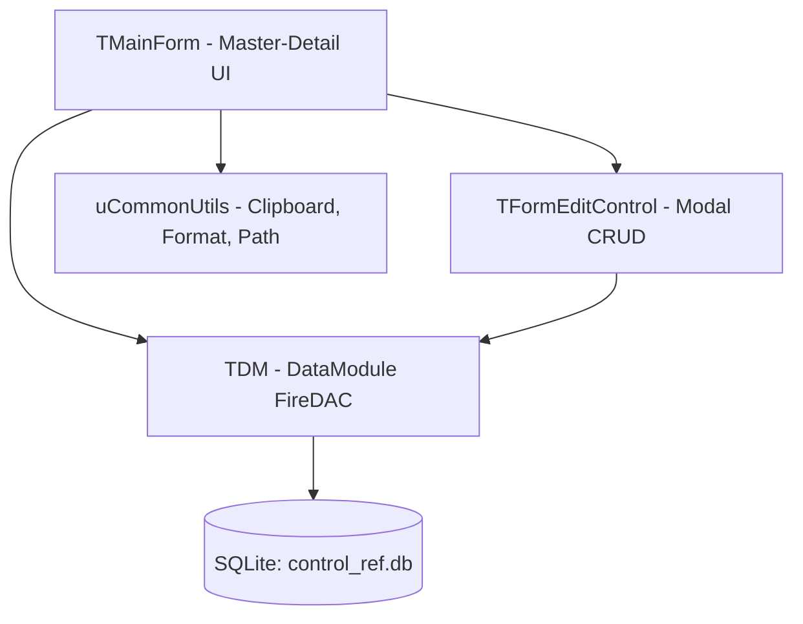
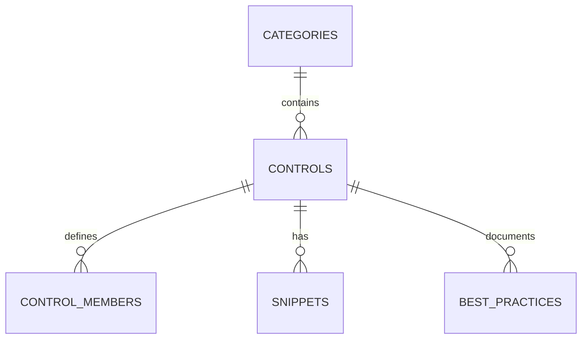

# Dokumen Arsitektur & Spesifikasi Teknis Lengkap
## Delphi Control Reference & Cheat Sheet (Production-Grade)

---

## 1. Ringkasan Eksekutif & Filosofi Desain

Aplikasi **Delphi Control Reference & Cheat Sheet** adalah aplikasi desktop berbasis **Embarcadero Delphi VCL** yang dirancang sebagai pusat pengetahuan (*knowledge base*) mandiri, cepat, dan luring (*offline*) untuk pengembang perangkat lunak Delphi modern.

### Filosofi Utama: Standar Produksi Nyata (*Production-Grade Engineering*)
Sebagian besar referensi pengembang hanya menyajikan contoh akademis atau *Hello World* yang tidak mencerminkan tantangan di lingkungan aplikasi enterprise nyata. Aplikasi ini dibangun dengan prinsip:
1. **Pola Desain Teruji (Battle-Tested Patterns)**: Menyajikan solusi validasi sanitasi input, pemformatan mata uang, manajemen state, pengikatan dataset, dan pemrosesan asinkron *multi-threading*.
2. **Katalog Gotchas & Pitfalls**: Mendokumentasikan perilaku bawaan VCL yang sering memicu *bug*, kebocoran memori (*memory leaks*), dan *freeze* antarmuka beserta solusi pencegahannya.
3. **Live Interactive Sandbox**: Menyediakan ruang uji langsung di dalam aplikasi (menggunakan runtime VCL itu sendiri) agar pengembang dapat mengamati interaksi kontrol secara langsung.
4. **Siklus Hidup Data Mandiri (Full CRUD)**: Memungkinkan penambahan, pengubahan, dan penghapusan referensi kontrol maupun potongan kode secara dinamis.

---

## 2. Arsitektur Sistem & Pola Desain (System Architecture)

Aplikasi dibangun dengan prinsip pemisahan tanggung jawab (*Separation of Concerns*) dan arsitektur modular:



### A. Pola Tata Letak Antarmuka (Master-Detail Layout)
* **Panel Kiri (Navigasi Hirarkis)**:
  * Menggunakan `TTreeView` (`tvControls`) untuk mengelompokkan kontrol ke dalam simpul kategori (*Category Node*) dan simpul kontrol (*Control Child Node*).
  * Dilengkapi kolom pencarian instan (`TEdit`) dengan mekanisme **Debounce Timer** (interval 250ms) untuk mencegah eksekusi query berulang saat pengguna mengetik cepat.
* **Pemisah Fleksibel**:
  * Menggunakan `TSplitter` (`splMain`) dengan batasan ukuran agar panel kiri dan kanan dapat disesuaikan ukurannya secara responsif.
* **Panel Kanan (Panel Detail Komprehensif)**:
  * **Header Card**: Kartu ringkasan nama kontrol, unit VCL, hirarki kelas pewarisan, dan tombol aksi `Ubah Kontrol` serta `Hapus`.
  * **TPageControl (`pcDetails`)**: Terdiri dari 4 lembar tab kerja:
    1. `tsMembers`: Properti, Event, dan Method via `TListView` (`vsReport`).
    2. `tsSnippets`: Penampil kode Pascal (font Consolas) + tombol salin ke clipboard satu klik + tombol hapus snippet.
    3. `tsBestPractices`: Penjelasan masalah umum di lapangan dan potongan kode solusi.
    4. `tsSandbox`: Area uji interaktif (*live runtime demo*).

### B. Lapisan Akses Data (Data Access Layer - FireDAC)
* Koneksi basis data diisolasi di dalam `TDataModule` (`uDataModule.pas`).
* Menggunakan driver resmi **FireDAC SQLite** (`TFDPhysSQLiteDriverLink` & `TFDConnection`) tanpa dependensi DLL pihak ketiga rumit (*zero external configuration*).
* Jalur database diselesaikan secara dinamis oleh `GetDatabasePath` di `uCommonUtils.pas` untuk mendukung eksekusi dari IDE, folder `bin/`, maupun direktori proyek root.

---

## 3. Kamus Data & Skema Basis Data SQLite

Struktur basis data diatur dengan `PRAGMA foreign_keys = ON;` dan aturan integritas bertingkat `ON DELETE CASCADE`.



### Rincian Tabel:

#### 1. Tabel `categories`
Menyimpan kelompok kategori kontrol dalam palet VCL.
| Kolom | Tipe | Keterangan |
| :--- | :--- | :--- |
| `id` | `INTEGER PRIMARY KEY AUTOINCREMENT` | ID unik kategori |
| `name` | `TEXT NOT NULL UNIQUE` | Nama kategori (Standard, Additional, Win32, Data-Aware, Dialogs) |
| `description` | `TEXT` | Deskripsi kelompok komponen |
| `sort_order` | `INTEGER DEFAULT 0` | Urutan tampil di navigasi |

#### 2. Tabel `controls`
Menyimpan data master komponen VCL.
| Kolom | Tipe | Keterangan |
| :--- | :--- | :--- |
| `id` | `INTEGER PRIMARY KEY AUTOINCREMENT` | ID unik kontrol |
| `category_id` | `INTEGER NOT NULL` | Relasi FK ke `categories(id)` (`ON DELETE CASCADE`) |
| `control_name` | `TEXT NOT NULL UNIQUE` | Nama kelas kontrol (misal: `TEdit`, `TButton`) |
| `unit_name` | `TEXT NOT NULL` | Unit deklarasi VCL (misal: `Vcl.StdCtrls`) |
| `inheritance` | `TEXT` | Rantai pewarisan kelas (misal: `TCustomEdit -> TWinControl`) |
| `description` | `TEXT NOT NULL` | Penjelasan fungsi umum |
| `recommended_use`| `TEXT` | Rekomendasi penggunaan terbaik di industri |

#### 3. Tabel `control_members`
Menyimpan rincian anggota properti, event, dan method.
| Kolom | Tipe | Keterangan |
| :--- | :--- | :--- |
| `id` | `INTEGER PRIMARY KEY AUTOINCREMENT` | ID unik |
| `control_id` | `INTEGER NOT NULL` | Relasi FK ke `controls(id)` (`ON DELETE CASCADE`) |
| `member_type` | `TEXT NOT NULL` | Jenis anggota (`PROPERTY`, `EVENT`, `METHOD`) |
| `member_name` | `TEXT NOT NULL` | Nama anggota (misal: `OnChange`, `Text`, `SelectAll`) |
| `data_type` | `TEXT` | Tipe data Pascal (misal: `TNotifyEvent`, `string`) |
| `description` | `TEXT NOT NULL` | Deskripsi fungsionalitas |
| `production_tip`| `TEXT` | Tips khusus implementasi di lingkungan produksi |

#### 4. Tabel `snippets`
Pustaka contoh potongan kode program siap salin.
| Kolom | Tipe | Keterangan |
| :--- | :--- | :--- |
| `id` | `INTEGER PRIMARY KEY AUTOINCREMENT` | ID unik |
| `control_id` | `INTEGER NOT NULL` | Relasi FK ke `controls(id)` (`ON DELETE CASCADE`) |
| `title` | `TEXT NOT NULL` | Judul skenario |
| `scenario_type` | `TEXT NOT NULL` | Kategori skenario (Formatting, Validation, Async, dll) |
| `complexity` | `TEXT DEFAULT 'Production'`| Tingkat kesulitan (Basic, Intermediate, Production) |
| `delphi_version`| `TEXT DEFAULT 'All'` | Kompatibilitas versi Delphi |
| `snippet_code` | `TEXT NOT NULL` | Kode sumber Object Pascal siap salin |
| `explanation` | `TEXT` | Penjelasan teknis dan dependensi unit |

#### 5. Tabel `best_practices`
Katalog perangkap (*gotchas*) dan solusi teknis.
| Kolom | Tipe | Keterangan |
| :--- | :--- | :--- |
| `id` | `INTEGER PRIMARY KEY AUTOINCREMENT` | ID unik |
| `control_id` | `INTEGER NOT NULL` | Relasi FK ke `controls(id)` (`ON DELETE CASCADE`) |
| `title` | `TEXT NOT NULL` | Judul permasalahan |
| `problem_description` | `TEXT NOT NULL` | Gejala dan akar masalah di lapangan |
| `solution_code` | `TEXT NOT NULL` | Rekomendasi solusi dan potongan kode |

---

## 4. Katalog 10 Kontrol VCL Produksi

| No | Kontrol | Kategori | Skenario Unggulan | Gotcha / Solusi Kritis |
| :---: | :--- | :--- | :--- | :--- |
| **1** | **`TEdit`** | Standard | Format Rupiah/Ribuan otomatis saat ketik | Cegah event `OnChange` terpicu saat form memuat data (`FIsLoadingData`). |
| **2** | **`TButton`** | Standard | Thread asinkron via `TTask.Run` + `TThread.Queue` | Cegah *double-click submission* dengan menonaktifkan tombol di awal. |
| **3** | **`TComboBox`** | Standard | Key-Value binding: Label string + ID database | Menghindari *memory leak* dengan pointer casting `TObject(NativeInt(ID))`. |
| **4** | **`TDBGrid`** | Data-Aware | Zebra striping selang-seling di `OnDrawColumnCell` | Jangan lakukan query SQL berat di dalam `OnDrawColumnCell`. |
| **5** | **`TListView`** | Win32 | Mode virtual list `OwnerData` untuk 100.000+ baris | Gunakan `BeginUpdate`/`EndUpdate` saat memuat banyak item. |
| **6** | **`TActionList`** | Standard | Kontrol terpusat status `Enabled` via `OnUpdate` | Jangan jalankan query database di `OnUpdate` karena dipicu tiap Windows Idle. |
| **7** | **`TDateTimePicker`** | Win32 | Filter rentang tanggal bersih dengan `DateOf()` | Hilangkan sisa jam/menit liar yang menyebabkan query SQL gagal cocok. |
| **8** | **`TStringGrid`** | Additional | Ekspor cepat matriks sel tabel ke CSV UTF-8 | Cegah *flickering* saat mengisi sel masif dengan pesan `WM_SETREDRAW`. |
| **9** | **`TPageControl`** | Win32 | Validasi kelengkapan form sebelum ganti tab di `OnChanging` | Sembunyikan tab menggunakan `TabVisible := False`, bukan `Visible := False`. |
| **10**| **`TMemo`** | Standard | Log console real-time dengan auto-scroll `SB_BOTTOM` | Cegah kebocoran memori dengan menghapus baris teratas jika melebihi kuota. |

---

## 5. Panduan Kompilasi & Menjalankan Proyek

### A. Persyaratan Sistem
* **Sistem Operasi**: Windows 10 atau Windows 11 (32-bit / 64-bit).
* **Lingkungan Pengembangan**: Embarcadero RAD Studio / Delphi (Delphi 10 Seattle s/d Delphi 12/13 Athens).

### B. Membuka & Mengompilasi di RAD Studio
Buka file proyek IDE di direktori utama:
```text
DelphiControlRef.dproj
```
Tekan **Shift+F9** (*Build*) atau **F9** (*Run*) untuk menghasilkan biner di `bin\DelphiControlRef.exe`.

### C. Kompilasi via Command Line (CLI)
Gunakan kompiler resmi Delphi `dcc32.exe` dari direktori root proyek:
```powershell
& "C:\Program Files (x86)\Embarcadero\Studio\37.0\bin\dcc32.EXE" -B -E"bin" `
  -NS"System;Winapi;Vcl;Vcl.Imaging;Data;FireDAC" `
  -I"src\Data;src\Forms;src\Models;src\Utils" `
  -U"src\Data;src\Forms;src\Models;src\Utils" `
  "DelphiControlRef.dpr"
```

### D. Inisialisasi Ulang Database (*Reset Seeder*)
Jika database `control_ref.db` ingin di-reset kembali ke kondisi awal, kompilasi dan jalankan utilitas `database\InitDatabase.dpr`.
